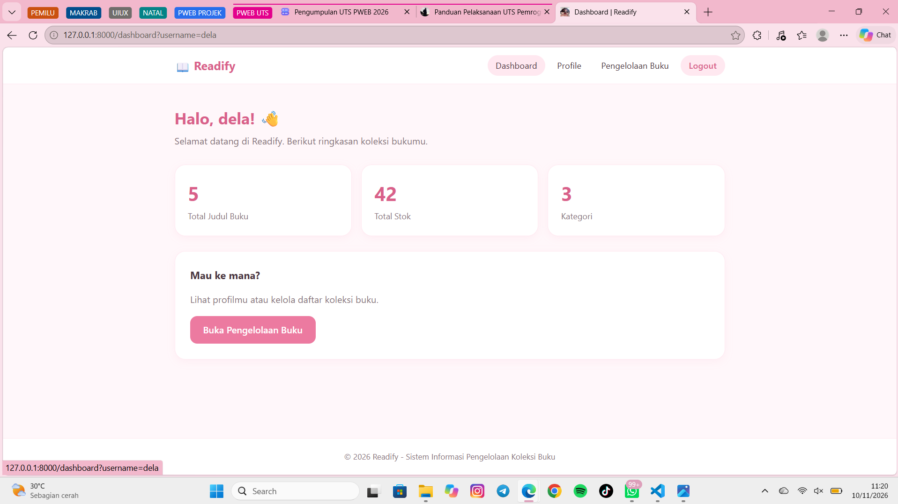
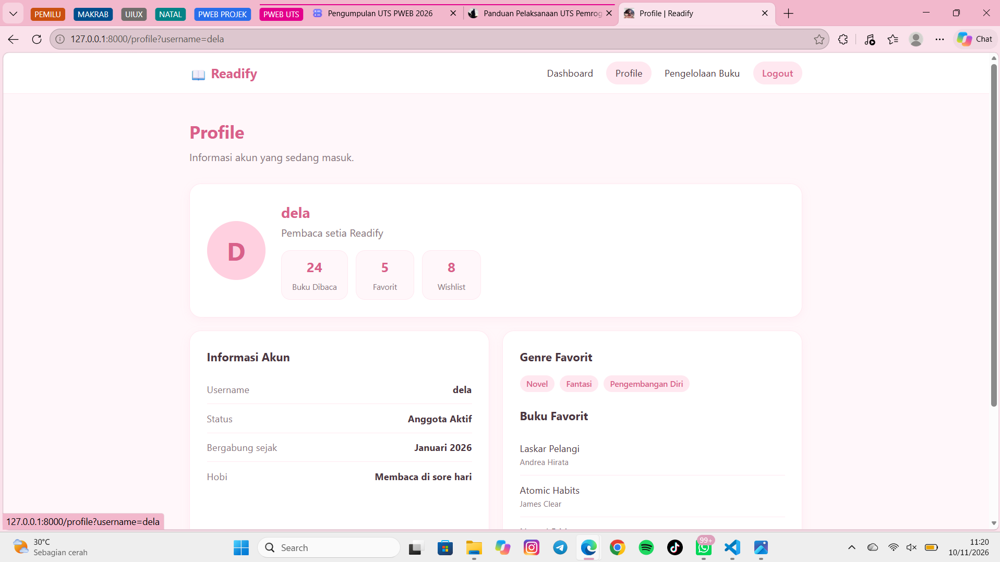

- Nama: Yohana Adela Simbolon
- NIM: 252410102018
- Kelas: PWEB A

# Readify - Sistem Pengelolaan Koleksi Buku

## Deskripsi Aplikasi
Readify merupakan aplikasi berbasis web yang dibuat untuk membantu user melihat dan mengelola informasi koleksi buku. Aplikasi ini dikembangkan menggunakan framework Laravel dengan tampilan sederhana dengan nuansa pink pastel dan putih.

## Fitur Aplikasi
- Login menggunakan username.
- Dashboard untuk menampilkan ringkasan koleksi buku.
- Halaman Profile untuk menampilkan informasi user.
- Pengelolaan buku untuk menampilkan daftar koleksi buku.
- Logout untuk keluar dari aplikasi.

## Teknologi yang Digunakan
- PHP
- Laravel
- Blade Template
- HTML
- CSS
- Laragon

## Konsep Laravel yang Digunakan
- Routing
- Controller
- View
- Request Parameter
- Blade Template
- Layout menggunakan @extends, @section, dan @yield
- @include
- Blade Component
- Perulangan @foreach

## Struktur Utama
- routes/web.php
- app/Http/Controllers/PageController.php
- resources/views/pengelolaan.blade.php
- resources/views/layouts/app.blade.php
- resources/views/dashboard.blade.php
- resources/views/login.blade.php

## Dokumentasi Tampilan Aplikasi

### 1. Halaman Login

Halaman login digunakan user untuk memasukkan username sebelum masuk ke aplikasi Readify.

### 2. Dashboard

Dashboard menampilkan sapaan user serta ringkasan informasi koleksi buku.

### 3. Profile

Halaman profile menampilkan informasi username pengguna.

### 4. Pengelolaan Buku

Halaman ini menampilkan daftar koleksi buku.

### 5. Logout

Tampilan setelah user melakukan logout.

